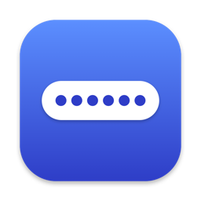
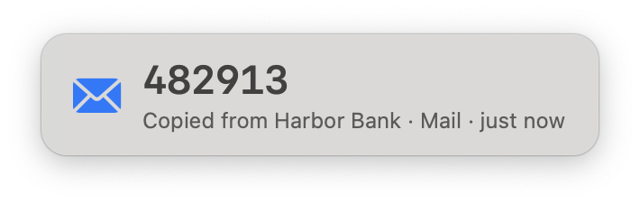
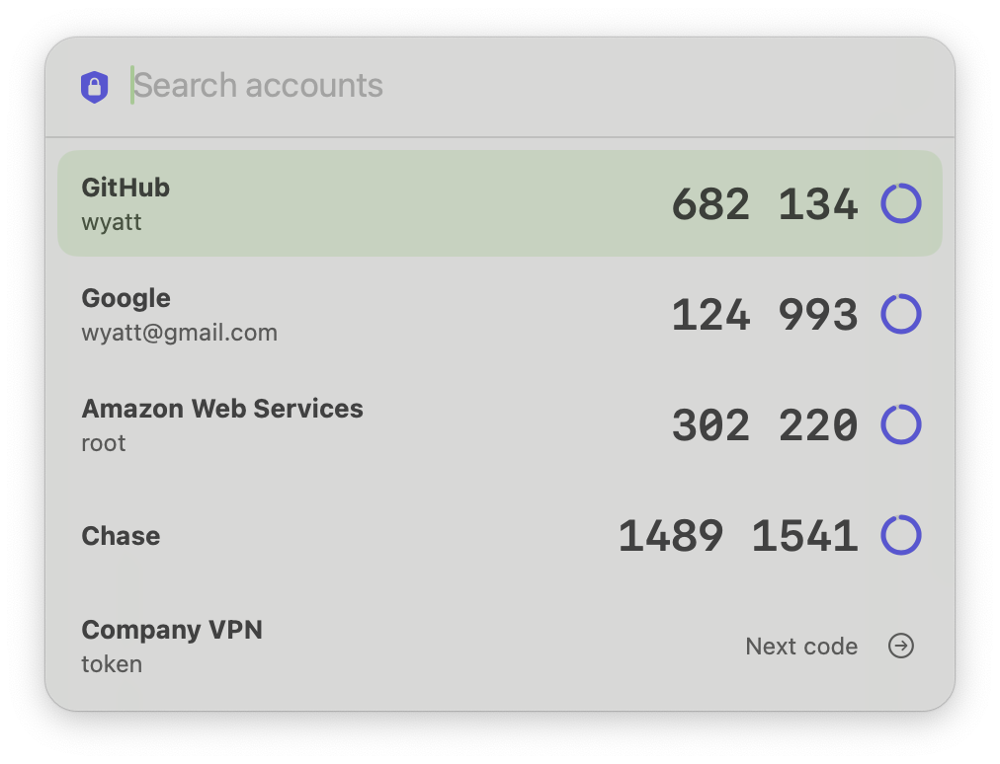
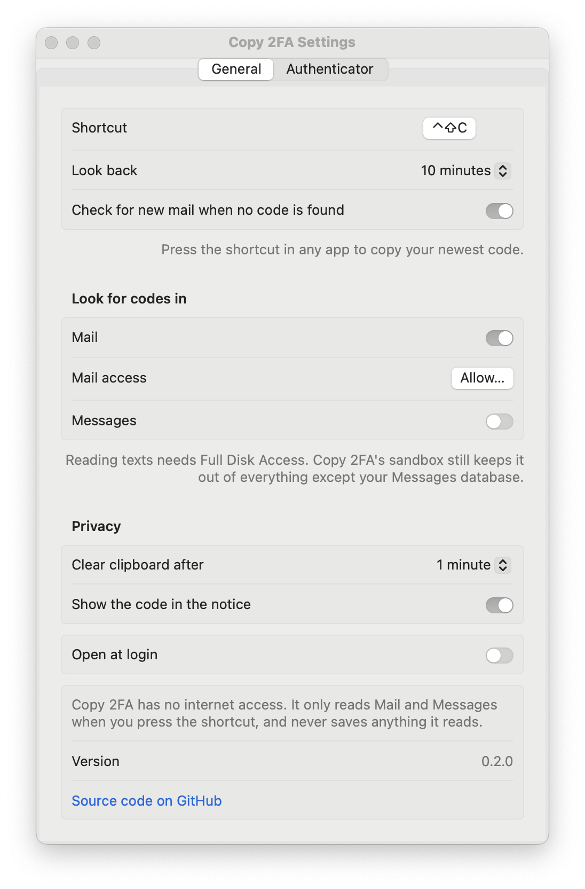

<p align="center">
  
</p>

<h1 align="center">Copy 2FA</h1>

<p align="center">
  <b>Copy 2FA codes on your Mac with one keyboard shortcut.</b><br>
  Verification codes from Mail and Messages, plus a built-in authenticator, in a free, open-source menu bar app.
</p>

<p align="center">
  <a href="https://github.com/stanczykwyatt/copy-2fa/releases/latest/download/Copy-2FA.zip"><b>Download for Mac</b></a>
  &nbsp;·&nbsp;
  <a href="windows/README.md">Windows preview</a>
  &nbsp;·&nbsp;
  <a href="https://stanczykwyatt.github.io/copy-2fa/">Website</a>
  &nbsp;·&nbsp;
  <a href="https://github.com/users/stanczykwyatt/projects/1">Roadmap</a>
  &nbsp;·&nbsp;
  <a href="https://github.com/stanczykwyatt/copy-2fa/discussions">Discussions</a>
</p>

<p align="center">
  <a href="https://github.com/stanczykwyatt/copy-2fa/actions/workflows/ci.yml"></a>
  <a href="https://github.com/stanczykwyatt/copy-2fa/releases/latest"></a>
  
  
  
  <a href="LICENSE"></a>
</p>

<p align="center">
  <picture>
    <source media="(prefers-color-scheme: dark)" srcset="docs/screenshots/notice-dark.png">
    
  </picture>
  <br>
  <picture>
    <source media="(prefers-color-scheme: dark)" srcset="docs/screenshots/picker-dark.png">
    
  </picture>
</p>

---

Tired of digging through your emails and texts for a 2FA code every five seconds? Use Copy 2FA! It's built for macOS, it has no internet access, so your codes stay on your Mac, and it's open source, so anyone can check. Setup is easy: download Copy 2FA and add your email accounts to Apple Mail. When you press the hotkey, Copy 2FA finds the most recent code in Mail or Messages and copies it to your clipboard. Codes from authenticator apps work too: bring your accounts over once, then pick one with a second shortcut.

If Copy 2FA saves you time, [starring the repo](https://github.com/stanczykwyatt/copy-2fa/stargazers) helps other people find it.

## Features

- **One shortcut for any code.** Press **⌃⇧C** in any app to copy the newest verification code from Mail or Messages. Works with Gmail, iCloud, Outlook, Yahoo and any other account you've added to Apple Mail, and with texted codes from banks, Duo and most websites.
- **A built-in authenticator.** Press **⌃⇧A**, use Touch ID, type a few letters and press Return. Supports time-based (TOTP) and counter-based (HOTP) codes.
- **Brings your accounts over.** Imports from Google Authenticator, Apple Passwords, 1Password, Bitwarden, Aegis, 2FAS, andOTP and [rsc/2fa](https://github.com/rsc/2fa), or from a QR code screenshot.
- **Shows where every code came from,** like *Copied from Harbor Bank · Mail · just now*.
- **Private by design.** No internet access, enforced by the macOS sandbox. Nothing it reads is saved, and the clipboard clears itself.
- **Free and open source.** No account, no subscription, no tracking.

## How it compares

| | Copy 2FA | [rsc/2fa](https://github.com/rsc/2fa) |
|---|:---:|:---:|
| Codes from email | ✅ | — |
| Codes from texts | ✅ | — |
| Authenticator codes | ✅ TOTP and HOTP | ✅ TOTP and HOTP |
| Works in any browser or app | ✅ | From Terminal |
| Secrets encrypted, behind Touch ID | ✅ | Stored in an unencrypted file |
| No Terminal needed | ✅ | — |
| Open source | ✅ | ✅ |

rsc/2fa is a great command-line tool. Copy 2FA is for people who'd rather press a shortcut, and it can import your `~/.2fa` keys in one step.

## Install

1. [Download **Copy-2FA.zip**](https://github.com/stanczykwyatt/copy-2fa/releases/latest/download/Copy-2FA.zip) and unzip it.
2. Move **Copy 2FA** to your Applications folder and open it.
3. Allow Mail access when asked, then press **⌃⇧C** the next time a code arrives.

> **About the security warning:** The first time you open Copy 2FA, macOS may say Apple couldn't verify that it's free of malware. It shows up because Copy 2FA isn't notarized yet: Apple charges developers $99 a year for that, and Copy 2FA hasn't paid the fee. The code is fully open source, so you can read every line or build the app yourself. To open it, go to **System Settings → Privacy & Security** and click **Open Anyway**.

### Build from source

You need macOS 14 or later and Swift 6, which comes with Xcode 16 or the Command Line Tools.

```bash
git clone https://github.com/stanczykwyatt/copy-2fa.git
cd copy-2fa
scripts/build-app.sh
open "build/Copy 2FA.app"
```

## Where codes come from

| Source | What it reads | What it needs |
|---|---|---|
| **Mail** | Every account you've added to Apple Mail (iCloud, Gmail, Outlook, Yahoo, Exchange or any other), including Junk | Your OK the first time, when macOS asks |
| **Messages** | Texts and iMessages, including codes sent by Duo, banks and most websites | Full Disk Access, which you turn on yourself. Off by default. |
| **Authenticator** | Accounts you've added to Copy 2FA, stored in your keychain | Touch ID or your Mac's password |

If an emailed code hasn't arrived yet, Copy 2FA asks Mail to check for new messages and looks again for a few seconds.

### Bringing your authenticator accounts over

In Settings → Authenticator, choose **Add Accounts**.

| App | How |
|---|---|
| **Apple Passwords** | In Passwords, choose **File → Export All Passwords**, import the CSV file, then delete it. |
| **Google Authenticator** | Use **Transfer accounts → Export accounts**, take a screenshot of the QR code, then import or paste it. |
| **1Password, Bitwarden** | Export as an unencrypted CSV or JSON file, import it, then delete it. |
| **Aegis, 2FAS, andOTP** | Export an unencrypted backup, import it, then delete it. |
| **rsc/2fa** | Choose **Import from 2fa…** and pick the `.2fa` file in your home folder. |
| **Authy** | Authy doesn't allow exports. Turn two-factor authentication off and on again on each website, then scan the new QR code. |
| **Duo** | Duo Push approvals have no code to copy. If Duo texts you passcodes, turn on Messages. |
| **Any website** | Screenshot its QR code and import it, paste its `otpauth://` link, or type the setup key it shows. |

## Privacy and security

Copy 2FA is built so it *can't* misuse your data, not just so it promises not to.

- **No internet access.** The app runs in the macOS App Sandbox without a network entitlement, so it can't send anything anywhere. CI checks every build for this.
- **Only reads when you press a shortcut,** and only the last 10 minutes of Mail and Messages. Nothing runs in the background.
- **Saves nothing it reads.** No logs, no history, no copies of your email or texts.
- **Locked-down file access.** Even with Full Disk Access, the sandbox only lets Copy 2FA read your Messages database and files you pick to import.
- **Authenticator secrets stay in your keychain,** are never synced or exported, need Touch ID to open, and are cleared from memory when the vault locks, your screen locks or your Mac sleeps.
- **Careful with the clipboard.** Codes stay off Universal Clipboard, are hidden from clipboard managers and are cleared automatically.
- **Hidden from screen sharing.** The code notice and the authenticator search ask macOS to keep them out of screenshots and recordings.
- **Minimal permissions.** The shortcuts work without Accessibility or Input Monitoring access, so Copy 2FA never sees what you type.
- **No dependencies.** Every line that runs is in this repository.

Check the app's permissions yourself with `codesign -d --entitlements - "/Applications/Copy 2FA.app"`. The full details are in [SECURITY.md](SECURITY.md).

## Settings

<picture>
  <source media="(prefers-color-scheme: dark)" srcset="docs/screenshots/settings-dark.png">
  
</picture>

**General:** change the shortcut, choose how far back to look (5 to 30 minutes), turn Mail and Messages on or off, choose when the clipboard clears, hide the code in the notice, and open Copy 2FA at login.

**Authenticator:** change its shortcut, choose how often to ask for Touch ID, and add or delete accounts.

Copy 2FA finds codes in English, Spanish, French, German, Chinese, Japanese, Korean and more. It handles six-digit codes, codes split into groups like `482 913`, and letter-and-number codes like `F4K9P` or `XKF-7PQ`. It skips prices, dates, phone numbers, order numbers, links and promo codes like `SAVE20`.

<br clear="right">

## FAQ

**How do I copy a 2FA code from email on a Mac?**
Add your email account to Apple Mail, open Copy 2FA, and press ⌃⇧C when the code arrives. The newest code is copied, ready to paste with ⌘V.

**Does it work with Gmail, Outlook and iCloud?**
Yes. Copy 2FA reads every account you've added to Apple Mail, whatever the provider.

**Can it read codes from Authy, Duo or Google Authenticator?**
Those apps don't let other apps read their codes. You can move Google Authenticator accounts over with its transfer QR code. Authy doesn't allow exports, so set those accounts up again with a new QR code. Duo passcodes sent by text are read from Messages.

**Is it safe?**
Copy 2FA can't connect to the internet, only reads messages when you press the shortcut, and keeps authenticator secrets in your keychain behind Touch ID. The code is open source, so anyone can check.

**Is there a Windows version?**
Yes, in preview. It reads Outlook and Thunderbird and has the same authenticator. See the [Windows README](windows/README.md).

**It missed a code or copied the wrong one.**
Please [open an issue](https://github.com/stanczykwyatt/copy-2fa/issues/new/choose) with the text around the code. Remove the real code and personal details first.

## More free Mac utilities

- **[Show Desktop](https://github.com/stanczykwyatt/show-desktop):** hide every window with one click or ⌃⇧D, then bring them all back exactly as they were. Like Windows+D for the Mac, with no internet access either.

## Contributing

Contributions are welcome. See [CONTRIBUTING.md](CONTRIBUTING.md), and the [roadmap](https://github.com/users/stanczykwyatt/projects/1) for what's planned. Ideas go in [Discussions](https://github.com/stanczykwyatt/copy-2fa/discussions/64).

## License

Copy 2FA is released under the [MIT License](LICENSE) and is provided as is, without warranty of any kind.

Copy 2FA is an independent project. It isn't affiliated with, endorsed by or sponsored by Apple Inc. or any other company named here. Apple, Mac, macOS, iMessage and Touch ID are trademarks of Apple Inc., registered in the U.S. and other countries. Other product names are trademarks of their owners and are used here only to describe compatibility.
